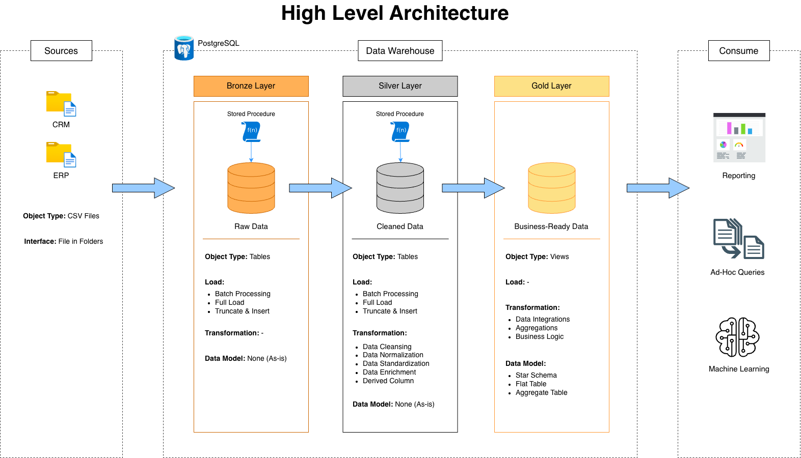
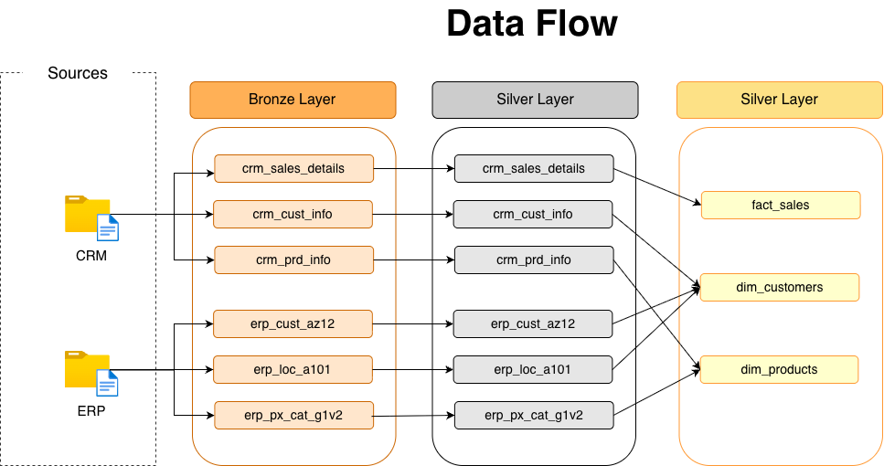
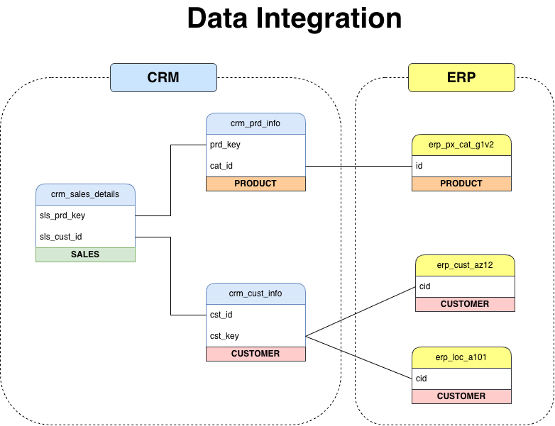
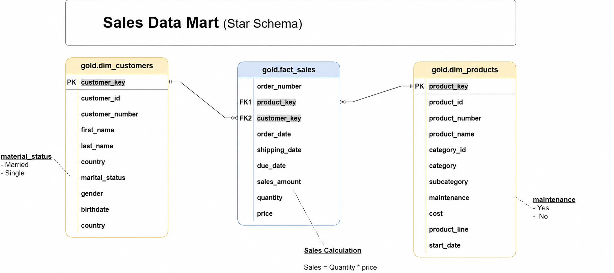

# 🏗️ Data Warehouse & Analytics Project

[](https://www.postgresql.org/)
[](https://dbeaver.io/)
[](https://www.drawio.com/)

This project builds a modern **Data Warehouse** using **PostgreSQL** with a **Medallion Architecture (Bronze → Silver → Gold)**. Data from two source systems (CRM & ERP) is consolidated into a single **Star Schema** analytical model, ready for reporting and business intelligence.

---

## 📖 Table of Contents

1. [Data Architecture](#-data-architecture)
2. [Data Flow](#-data-flow)
3. [Data Integration](#-data-integration)
4. [Data Modelling](#-data-modelling)
5. [Repository Structure](#-repository-structure)
6. [Getting Started](#-getting-started)
7. [Tools Used](#%EF%B8%8F-tools-used)

---

## 🏛️ Data Architecture



This project follows the **Medallion Architecture** consisting of 3 layers:

| Layer | Object Type | Description |
|-------|------------|-------------|
| **🥉 Bronze** | Tables | Stores raw data **as-is** from source systems. Data is ingested from CSV files using stored procedures with a **Truncate & Insert** strategy. |
| **🥈 Silver** | Tables | Data cleansing layer: **cleansing**, **standardization**, **normalization**, and **derived columns**. Loaded via stored procedures with **Truncate & Insert**. |
| **🥇 Gold** | Views | Business-ready data modeled as a **Star Schema**. This layer integrates data from multiple sources, applies business logic, and serves reporting & analytics needs. |

---

## 🔄 Data Flow



Data flows from source to destination as follows:

- **CRM** → 3 tables: `crm_sales_details`, `crm_cust_info`, `crm_prd_info`
- **ERP** → 3 tables: `erp_cust_az12`, `erp_loc_a101`, `erp_px_cat_g1v2`

Each table passes through the **Bronze → Silver → Gold** pipeline, where in the Gold layer data is combined into:
- `fact_sales` — Fact table for sales transactions
- `dim_customers` — Customer dimension
- `dim_products` — Product dimension

---

## 🔗 Data Integration



The integration model shows how tables from CRM and ERP are connected:

- **Sales ↔ Product**: `crm_sales_details.sls_prd_key` → `crm_prd_info.prd_key`
- **Sales ↔ Customer**: `crm_sales_details.sls_cust_id` → `crm_cust_info.cst_id`
- **Product ↔ Category**: `crm_prd_info.cat_id` → `erp_px_cat_g1v2.id`
- **Customer ↔ Demographics**: `crm_cust_info.cst_key` → `erp_cust_az12.cid`
- **Customer ↔ Location**: `crm_cust_info.cst_key` → `erp_loc_a101.cid`

---

## ⭐ Data Modelling



The Gold layer is modeled using a **Star Schema** consisting of:

### `gold.dim_customers`
Customer dimension enriched with demographic and geographic data from CRM + ERP.

### `gold.dim_products`
Product dimension including category, subcategory, product line, and cost information.

### `gold.fact_sales`
Fact table storing transactional sales data: order, shipping, due date, quantity, price, and sales amount. Formula: **Sales = Quantity × Price**.

> 📄 For detailed column descriptions, see the [Data Catalog](docs/data_catalog.md).

---

## 📂 Repository Structure

```
data-warehouse-project/
│
├── datasets/                           # Raw datasets (CSV) from source systems
│   ├── source_crm/                     # CRM data (cust_info, prd_info, sales_details)
│   └── source_erp/                     # ERP data (CUST_AZ12, LOC_A101, PX_CAT_G1V2)
│
├── docs/                               # Project documentation & diagrams
│   ├── data_architecture.png           # High-level architecture diagram
│   ├── data_flow.png                   # Data flow diagram across layers
│   ├── data_integration.png            # CRM & ERP table integration diagram
│   ├── data_modelling.png              # Star Schema diagram (Gold layer)
│   ├── data_catalog.md                 # Column descriptions & metadata for Gold layer
│   └── naming_conventions.md           # Naming guidelines for tables, columns, and procedures
│
├── scripts/                            # SQL scripts for ETL & transformations
│   ├── init_server.sql                 # Database initialization
│   ├── init_databases.sql              # Schema creation (bronze, silver, gold)
│   ├── bronze/
│   │   ├── ddl_bronze.sql              # DDL for Bronze tables
│   │   └── proc_load_bronze.sql        # Stored procedure to load data into Bronze
│   ├── silver/
│   │   ├── ddl_silver.sql              # DDL for Silver tables
│   │   └── proc_load_silver.sql        # Stored procedure to load data into Silver
│   └── gold/
│       └── ddl_gold.sql                # DDL for Gold views (Star Schema)
│
├── tests/                              # Quality check scripts
│   ├── quality_check_silver.sql        # Silver layer data validation
│   └── quality_check_gold.sql          # Gold layer data validation
│
├── .gitignore                          # Files/folders ignored by Git
└── README.md                           # Project documentation (this file)
```

---

## 🚀 Getting Started

### Prerequisites
- **PostgreSQL** installed and running
- **DBeaver** (or any SQL client) to execute the scripts

### Step-by-Step Execution

```
1️⃣  Create database       →  Run scripts/init_server.sql
2️⃣  Create schemas         →  Run scripts/init_databases.sql
3️⃣  Create Bronze tables   →  Run scripts/bronze/ddl_bronze.sql
4️⃣  Load Bronze data       →  Run scripts/bronze/proc_load_bronze.sql
5️⃣  Create Silver tables   →  Run scripts/silver/ddl_silver.sql
6️⃣  Load Silver data       →  Run scripts/silver/proc_load_silver.sql
7️⃣  Create Gold views      →  Run scripts/gold/ddl_gold.sql
8️⃣  Run quality checks     →  Run tests/quality_check_silver.sql
                               Run tests/quality_check_gold.sql
```

> **Note:** Execute scripts in order, as each layer depends on the previous one.

---

## 🛠️ Tools Used

| Tool | Purpose |
|------|---------|
| **[PostgreSQL](https://www.postgresql.org/)** | Database engine for storing and managing the data warehouse |
| **[DBeaver](https://dbeaver.io/)** | GUI database client for running queries and managing databases |
| **[Draw.io](https://www.drawio.com/)** | Designing architecture, data flow, and data model diagrams |
| **[Git & GitHub](https://github.com/)** | Version control and code collaboration |

---

## 📚 Additional Documentation

- [Data Catalog](docs/data_catalog.md) — Detailed description of every column in the Gold layer
- [Naming Conventions](docs/naming_conventions.md) — Naming guidelines for tables, columns, and stored procedures
